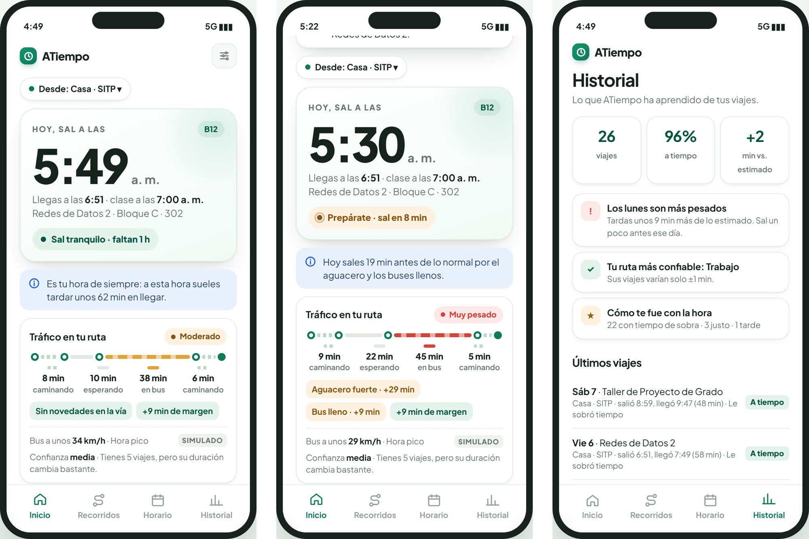

# ATiempo · Prototipo

ATiempo le dice a un estudiante a qué hora debe salir de su casa para llegar puntual a clase. Para calcularlo usa su recorrido, el tráfico del día y lo que suele tardar en sus viajes anteriores.

## Ver el prototipo

- **Versión 2 (actual):** abre `index.html` o el enlace de GitHub Pages del repositorio.
- **Versión 1:** está en la carpeta `version-1`.

Necesita internet, porque carga React y el mapa desde la web. No requiere instalar nada.

**Para probarlo:** entra con «Probar con datos de ejemplo» y usa el **panel de prueba** de la derecha. En celular, el panel se abre con el botón «Panel de prueba». Con él puedes simular lluvia, trancón, obras del Metro, bus lleno, falta de conexión y otras situaciones, y ver cómo cambia la hora de salida.

## Funcionalidades

- Hora de salida recomendada, hora de llegada y estado («Sal tranquilo», «Prepárate», «Sal ya», «Vas tarde»).
- Frase corta que explica por qué esa hora y tarjeta con el tráfico de la ruta por tramos.
- Varios recorridos, con mapa para marcar el origen y el destino, y comparación de rutas según el riesgo de llegar tarde.
- Horario de clases y una salida calculada para cada clase.
- Registro de viajes («Ya salí» / «Ya llegué»), pregunta de cómo te fue y sugerencia de más margen si llegas tarde seguido.
- Historial con lo que la app aprende: el día más pesado y la ruta más confiable.
- Avisos de preparación, de salida y de cambio de hora.

## Cómo calcula la hora

Usa la fórmula de la propuesta: D = w·H̄ + (1 − w)·E, con w = n/(n + 5), y la hora de salida S = T − (D + z·σ + M). El tráfico es **simulado** y los datos se guardan en el navegador (`localStorage`). No hay backend.

## Uso de IA

El prototipo se construyó con ayuda de Claude (Anthropic). Los prompts finales están en la carpeta [`docs`](docs).

## Equipo

Felipe Mejía Alvarado · David José Salazar · José Luis Moreno
Seminario de Investigación · Facultad de Ingeniería · Universidad El Bosque · 2026
